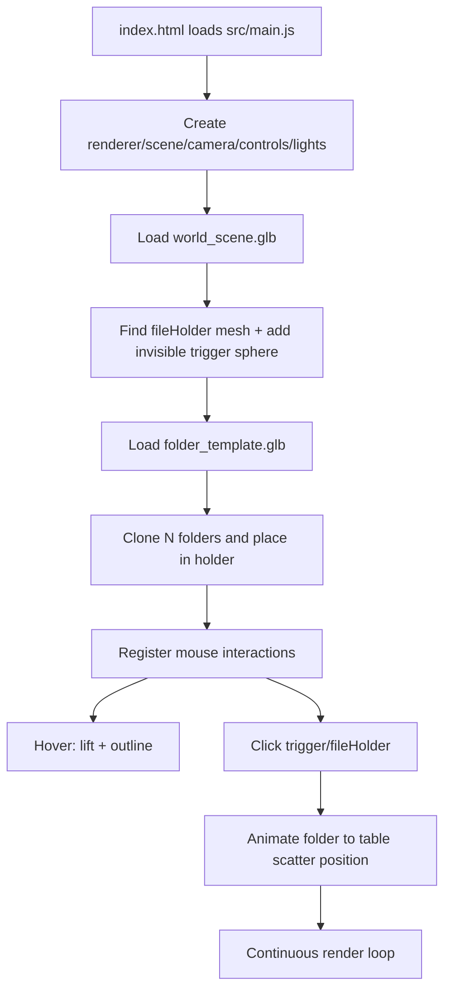

# Web Portfolio Documentation

## 1) Project Goal

This website is an interactive 3D portfolio experience built with Three.js.

The main idea is:

- Render a stylized 3D world (desk/table scene) in the browser.
- Spawn a stack of folder models inside a holder in the world.
- Let users interact with those folders using mouse hover and click.
- Animate folders from the holder onto the table in a natural scattered layout.

In practical terms, the site demonstrates both visual design and frontend engineering through real-time graphics, interaction logic, and animation choreography.

## 2) Tech Stack

- Vite for development server and bundling
- Three.js for 3D scene rendering
- GSAP for timeline-based animation
- Sass for styling
- GLTF + Draco decoding for compressed 3D assets

Dependency source: package.json scripts and dependencies.

## 3) Runtime Architecture

The app is modular and separated by responsibility:

- Core setup (renderer, scene, camera, lights, resize)
- Asset loading (GLTF + Draco)
- Camera controls (OrbitControls)
- World loading (environment model + file holder detection)
- Folder lifecycle
  - spawn
  - hover
  - click trigger
  - animated scatter to table

### High-level flow

## 4) File and Module Breakdown

## Entry and page shell

- index.html
  - Defines basic page shell.
  - Loads src/main.js as module.
  - Includes a canvas container element, although renderer canvas is appended directly to body by current scene setup.

- src/style.scss
  - Minimal global reset and root typography/rendering defaults.

## Application bootstrap

- src/main.js
  - Orchestrates entire startup.
  - Creates renderer, scene, camera, controls.
  - Adds lights and resize handling.
  - Loads world and folder template assets.
  - Clones folders and stores folder state objects.
  - Installs interaction system.
  - Runs animation/render loop.

Important state in main.js:

- folders: array of folder state objects
  - mesh
  - isAnimating
  - index
  - plus hover-related properties attached later
- fileHolderMesh: reference to holder anchor in world model
- TABLE_SCATTER_BOUNDS: world-space area for final folder landing positions

## Core scene utilities

- src/core/scene.js
  - createRenderer()
    - WebGLRenderer, antialias enabled
    - SRGB output color space
    - shadows enabled with PCF soft shadows
    - appends renderer canvas to document body
  - createScene()
    - plain background color
  - createCamera()
    - Perspective camera positioned above/away from scene
  - addLights(scene)
    - ambient + key lamp + fill light
    - key lamp casts shadows
  - bindResize(camera, renderer)
    - updates camera aspect/projection and renderer size on resize

- src/core/loaders.js
  - createGltfLoader()
    - Creates DRACOLoader and GLTFLoader
    - Configures Draco decoder path to Google-hosted decoder
    - Enables loading Draco-compressed meshes in .glb files

## Camera module

- src/features/camera/cameraController.js
  - createCameraControls(camera, domElement)
    - OrbitControls with damping enabled
    - Sets control target so camera orbits around desk area

## World loading module

- src/features/world/worldLoader.js

Responsibilities:

- Load world_scene.glb from public/models
- Traverse world scene and enable shadows/material color space
- Detect mesh named fileHolder
- Create invisible clickable sphere near holder
- Load folder_template.glb
- Return template for cloning

Key behavior:

- If fileHolder is found:
  - logs local/world transform
  - injects a transparent sphere mesh with userData.type = folderTrigger
  - this sphere acts as a large click target to reliably trigger folder animations
- Uses Promise wrapper for GLTFLoader callbacks.

## Folder spawn module

- src/features/folders/folderSpawner.js

Responsibilities:

- Clone folder template multiple times
- Place clones in holder stack using fixed base position and computed z spacing
- Set folder clone rotation
- Ensure mesh children cast/receive shadows and use SRGB map color space
- Return folder state objects used throughout interactions/animations

Returned folder data shape:

- mesh: Three.js object
- isAnimating: boolean lock to prevent conflicting animations
- index: folder index

## Folder animation module

- src/features/folders/folderAnimations.js

This module does two main things:

- Computes a non-overlapping scatter layout inside table bounds.
- Runs GSAP timeline that moves each folder from holder to table.

Scatter generation details:

1. Bounds are configurable through setFolderScatterBounds().
2. For a given folder count + bounds, layout is cached.
3. Layout generation:
   - divide area into grid cells
   - choose anchor points
   - add jitter and random yaw
   - estimate rotated folder extents
   - run iterative relaxation to reduce overlaps and keep spacing
   - add subtle tilt/z-rotation variation and tiny vertical stack lift

Animation sequence in animateFolderToTable():

1. Mark folder as animating.
2. Lift upward quickly.
3. Teleport to an off-table staging point (simulates throw/drop source).
4. Animate to computed table position and rotation.
5. Mark animation complete.

Result: folders feel naturally scattered rather than placed in rigid rows.

## Folder interaction module

- src/features/folders/folderInteractions.js

This module wires all pointer interactions.

### Hover behavior

- Each folder gets an invisible sphere collider child.
- Raycaster checks colliders on mouse move.
- Hovered folder:
  - gets black edge outlines generated from mesh edges
  - smoothly lifts upward
- On unhover:
  - outline hidden
  - folder returns to original Y

### Click behavior

On click, raycaster checks all scene intersections:

- If a folderTrigger sphere is hit:
  - triggers animation callback (all folders, in current main.js logic)
- Else if fileHolder mesh/hierarchy is hit:
  - picks first non-animating folder
  - triggers single-folder animation callback
- Else:
  - no folder action

Interaction module exposes cleanup function that removes listeners and disposes hover collider resources.

## Music module

- src/features/music/musicPlayer.js

Responsibilities:

- Loop the background track from public/audio/music.mp3 (MUSIC_SRC)
- Start it on the visitor's first click or key press, fading in (browsers block sound before a gesture)
- Wire the top-left controls in index.html: mute button and volume slider
- Remember mute and volume in localStorage
- Keep the controls hidden if the track is missing or fails to load

## 5) Asset Pipeline

Assets are loaded from:

- public/models/world_scene.glb
- public/models/folder_template.glb
- public/audio/music.mp3 (background music, optional)

Why this matters:

- Vite serves files in public directly from root URL.
- World module references assets using /models/... URLs.
- Draco decoder URL is remote and required if models contain Draco-compressed geometry.

## 6) Rendering and Update Loop

Main loop is requestAnimationFrame based:

1. controls.update() for OrbitControls damping
2. renderer.render(scene, camera)
3. repeat

Animations are managed independently by GSAP timelines but rendered by same Three.js frame loop.

## 7) Coordinate System and Placement Strategy

Folder motion relies on world-space placement constants.

- Holder spawn constants in folderSpawner.js define initial stacked location.
- TABLE_SCATTER_BOUNDS in main.js defines destination play area.
- folderAnimations.js uses folder footprint and rotation-aware extents to keep objects inside bounds and reduce overlap.

This design keeps visual tuning easy: adjust a few constants without rewriting animation logic.

## 8) How to Run

Development:

1. npm install
2. npm run dev

Production build:

1. npm run build
2. npm run preview

## 9) Current Behavior Summary

- Scene boots and world model loads.
- Holder anchor is discovered by name fileHolder.
- Folder templates are cloned into holder.
- Hovering folders gives lift + outline feedback.
- Clicking trigger/holder sends folders to table with staggered GSAP animation.

## 10) Strengths of Current Implementation

- Clear modular separation by feature.
- Robust loading path for Draco-compressed GLTF.
- Interaction is tolerant because of invisible trigger collider.
- Scatter layout includes overlap mitigation, not pure random placement.

## 11) Practical Limitations and Improvement Ideas

Potential improvements:

- Consistency of canvas mounting
  - index.html contains a canvas wrapper, but renderer currently appends to body directly.
  - Option: append renderer into .experience-canvas or dedicated mount element.

- Excessive debug logging
  - click/loader logs are verbose in production.
  - Option: gate logs by dev flag.

- Interaction targeting
  - trigger sphere position is currently hard-coded instead of derived from holder transform.
  - Option: attach trigger directly to fileHolder or compute from holder bounds.

- Lifecycle cleanup
  - createFolderInteraction returns disposer but bootstrap does not store/use it.
  - Option: keep cleanup for hot reload or route transitions.

- Styling/UI layer
  - current CSS is minimal and mostly 3D-canvas focused.
  - Option: add portfolio overlays, labels, and camera-state-driven UI.

## 12) Mental Model for Future Features

To add a portfolio item reveal flow:

1. Add metadata per folder in folders array.
2. On folder click, animate folder open (GSAP + model parts).
3. Show HTML overlay card tied to that folder metadata.
4. Optionally move camera toward active folder.

Because modules are separated, this can be implemented mostly by extending:

- folderInteractions.js for selection logic
- folderAnimations.js for open/close choreography
- main.js for orchestration and data wiring

---

If needed, this can be expanded into:

- function-level API documentation
- event/state diagrams
- asset naming conventions and authoring checklist
- contributor guide with coding standards and testing strategy