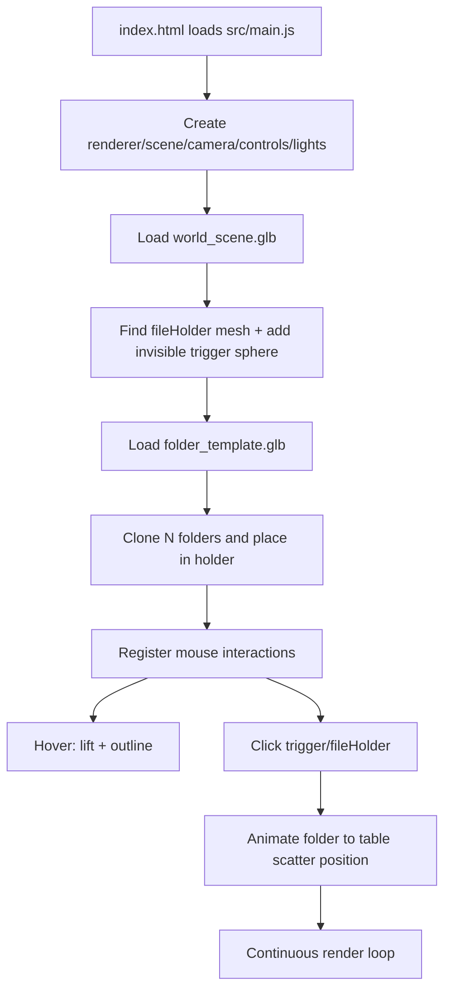

# Web Portfolio Documentation

## 1) Project Goal

This website is an interactive 3D portfolio experience built with Three.js.

The main idea is:

- Render a stylized 3D world (desk/table scene) in the browser.
- Spawn a stack of folder models inside a holder in the world.
- Let users interact with those folders using mouse hover and click.
- Animate folders from the holder onto the table in a natural scattered layout.

In practical terms, the site demonstrates both visual design and frontend engineering through real-time graphics, interaction logic, and animation choreography.

## 2) Tech Stack

- Vite for development server and bundling
- Three.js for 3D scene rendering
- GSAP for timeline-based animation
- Sass for styling
- GLTF + Draco decoding for compressed 3D assets

Dependency source: package.json scripts and dependencies.

## 3) Runtime Architecture

The app is modular and separated by responsibility:

- Core setup (renderer, scene, camera, lights, resize)
- Asset loading (GLTF + Draco)
- Camera controls (OrbitControls)
- World loading (environment model + file holder detection)
- Folder lifecycle
  - spawn
  - hover
  - click trigger
  - animated scatter to table

### High-level flow

## 4) File and Module Breakdown

## Entry and page shell

- index.html
  - Defines basic page shell.
  - Loads src/main.js as module.
  - Includes a canvas container element, although renderer canvas is appended directly to body by current scene setup.

- src/style.scss
  - Minimal global reset and root typography/rendering defaults.

## Application bootstrap

- src/main.js
  - Orchestrates entire startup.
  - Creates renderer, scene, camera, controls.
  - Adds lights and resize handling.
  - Loads world and folder template assets.
  - Clones folders and stores folder state objects.
  - Installs interaction system.
  - Runs animation/render loop.

Important state in main.js:

- folders: array of folder state objects
  - mesh
  - isAnimating
  - index
  - plus hover-related properties attached later
- fileHolderMesh: reference to holder anchor in world model
- TABLE_SCATTER_BOUNDS: world-space area for final folder landing positions

## Core scene utilities

- src/core/scene.js
  - createRenderer()
    - WebGLRenderer, antialias enabled
    - SRGB output color space
    - shadows enabled with PCF soft shadows
    - appends renderer canvas to document body
  - createScene()
    - plain background color
  - createCamera()
    - Perspective camera positioned above/away from scene
  - addLights(scene)
    - ambient + key lamp + fill light
    - key lamp casts shadows
  - bindResize(camera, renderer)
    - updates camera aspect/projection and renderer size on resize

- src/core/loaders.js
  - createGltfLoader()
    - Creates DRACOLoader and GLTFLoader
    - Configures Draco decoder path to Google-hosted decoder
    - Enables loading Draco-compressed meshes in .glb files

## Camera module

- src/features/camera/cameraController.js
  - createCameraControls(camera, domElement)
    - OrbitControls with damping enabled
    - Sets control target so camera orbits around desk area

## World loading module

- src/features/world/worldLoader.js

Responsibilities:

- Load world_scene.glb from public/models
- Traverse world scene and enable shadows/material color space
- Detect mesh named fileHolder
- Create invisible clickable sphere near holder
- Load folder_template.glb
- Return template for cloning

Key behavior:

- If fileHolder is found:
  - logs local/world transform
  - injects a transparent sphere mesh with userData.type = folderTrigger
  - this sphere acts as a large click target to reliably trigger folder animations
- Uses Promise wrapper for GLTFLoader callbacks.

## Folder spawn module

- src/features/folders/folderSpawner.js

Responsibilities:

- Clone folder template multiple times
- Place clones in holder stack using fixed base position and computed z spacing
- Set folder clone rotation
- Ensure mesh children cast/receive shadows and use SRGB map color space
- Return folder state objects used throughout interactions/animations

Returned folder data shape:

- mesh: Three.js object
- isAnimating: boolean lock to prevent conflicting animations
- index: folder index

## Folder animation module

- src/features/folders/folderAnimations.js

This module does two main things:

- Computes a non-overlapping scatter layout inside table bounds.
- Runs GSAP timeline that moves each folder from holder to table.

Scatter generation details:

1. Bounds are configurable through setFolderScatterBounds().
2. For a given folder count + bounds, layout is cached.
3. Layout generation:
   - divide area into grid cells
   - choose anchor points
   - add jitter and random yaw
   - estimate rotated folder extents
   - run iterative relaxation to reduce overlaps and keep spacing
   - add subtle tilt/z-rotation variation and tiny vertical stack lift

Animation sequence in animateFolderToTable():

1. Mark folder as animating.
2. Lift upward quickly.
3. Teleport to an off-table staging point (simulates throw/drop source).
4. Animate to computed table position and rotation.
5. Mark animation complete.

Result: folders feel naturally scattered rather than placed in rigid rows.

## Folder interaction module

- src/features/folders/folderInteractions.js

This module wires all pointer interactions.

### Hover behavior

- Each folder gets an invisible sphere collider child.
- Raycaster checks colliders on mouse move.
- Hovered folder:
  - gets black edge outlines generated from mesh edges
  - smoothly lifts upward
- On unhover:
  - outline hidden
  - folder returns to original Y

### Click behavior

On click, raycaster checks all scene intersections:

- If a folderTrigger sphere is hit:
  - triggers animation callback (all folders, in current main.js logic)
- Else if fileHolder mesh/hierarchy is hit:
  - picks first non-animating folder
  - triggers single-folder animation callback
- Else:
  - no folder action

Interaction module exposes cleanup function that removes listeners and disposes hover collider resources.

## Music module

- src/features/music/musicPlayer.js

Responsibilities:

- Loop the background track from public/audio/music.mp3 (MUSIC_SRC)
- Start it on the visitor's first click or key press, fading in (browsers block sound before a gesture)
- Wire the top-left controls in index.html: mute button and volume slider (full slider = MAX_VOLUME, kept low for background music)
- Remember mute and volume in localStorage
- Keep the controls hidden if the track is missing or fails to load

## Portrait / phone mode

- src/core/layout.js
  - One switch for the whole site: matchMedia('(orientation: portrait)'), i.e. the screen is taller than wide.
  - Landscape (desktops, phones held sideways) keeps the desktop experience unchanged.
  - Portrait (phones held upright, narrow windows) gets a touch-first layout. style.scss uses the same media query, so CSS and JS always agree.
  - Rotating mid-visit closes whatever is open, puts folders and board items back, and continues from the same view in the other layout (main.js, portraitQuery change listener).

What portrait changes:

- Room view: the desktop hotspots and edge arrows are hidden. Two big frosted tiles, "Projects" and "Info Board", sit along the bottom, and the camera frames the desk and most of the board a little closer.
- Projects (src/features/folders/folderRing.js): the folders lift out of the holder into a floating ring over the desk, like the Silent Hill 2 inventory.
  - Drag or flick to spin it; it settles with the nearest folder at the front.
  - ‹ › and the arrow keys step it. Tapping a side folder spins it round to the front.
  - Tapping the front folder opens it. The others shrink away, and the opened folder lies on the desk as on desktop.
  - The camera shows one page at a time; ‹ › at the bottom flies between the two pages (OPEN_PAGES in folderAnimations.js).
  - Closing flies the folder back into the ring; × returns everything to the holder.
- Info Board: the items stay pinned. The camera hops between them left to right (swipe, ‹ ›, or tap another item), starting on About Me. The focused item lifts as if hovered (boardLinks.focus), and tapping it opens it.
- PDFs: phone browsers can't show a PDF inside the page. A project's documents and slides open in a new tab. The right page shows a "Read the …" card instead of the embedded PDF. A board document shows its first-page image, with an "Open PDF" button.
- Notes (About Me, Skills) open as a readable text card instead of their shrunken drawing.

Framing (src/features/camera/cameraController.js):

- Portrait views aren't fixed poses. fitPose() finds the nearest camera distance at which the given boxes fit the screen's current shape, so every phone size is framed.
- PORTRAIT_VIEWS holds each view's viewing direction, how much of the screen it fills, and how far it's lifted above the bottom controls. Tune those, plus RING_CENTRE / RING_RADIUS in folderRing.js.
- To try it on a phone: npx vite --host, then open the printed network URL. Or narrow the desktop window until it's taller than wide.

Phones (pointer: coarse) also render at most 2 pixels per CSS pixel (src/core/scene.js); desktops are unchanged.

## 5) Asset Pipeline

Assets are loaded from:

- public/models/world_scene.glb
- public/models/folder_template.glb
- public/audio/music.mp3 (background music, optional)

Why this matters:

- Vite serves files in public from the site's base URL (vite.config.js base, '/' on rakhatb.com).
- Code writes public paths from the root (/models/..., /docs/..., /projects/...) and wraps them in publicUrl() (src/core/paths.js), which adds the base. projects.js and the board's documents do this for you, so keep writing /projects/... there.
- Draco decoder URL is remote and required if models contain Draco-compressed geometry.

## 6) Rendering and Update Loop

Main loop is requestAnimationFrame based:

1. controls.update() for OrbitControls damping
2. renderer.render(scene, camera)
3. repeat

Animations are managed independently by GSAP timelines but rendered by same Three.js frame loop.

## 7) Coordinate System and Placement Strategy

Folder motion relies on world-space placement constants.

- Holder spawn constants in folderSpawner.js define initial stacked location.
- TABLE_SCATTER_BOUNDS in main.js defines destination play area.
- folderAnimations.js uses folder footprint and rotation-aware extents to keep objects inside bounds and reduce overlap.

This design keeps visual tuning easy: adjust a few constants without rewriting animation logic.

## 8) How to Run

Development:

1. npm install
2. npm run dev, then open http://localhost:5173/

Production build:

1. npm run build
2. npm run preview

Deploying (GitHub Pages):

- Live at https://rakhatb.com (custom domain, DNS at Namecheap).
- Every push to main rebuilds and publishes the site (.github/workflows/deploy.yml), in about 1–2 minutes. Progress and errors show in the repo's Actions tab.
- One-time setup: repo Settings → Pages → Source: GitHub Actions, and Custom domain: rakhatb.com.
- DNS (Namecheap → Advanced DNS): A records for @ → 185.199.108.153, 185.199.109.153, 185.199.110.153, 185.199.111.153; CNAME www → rakhat-b.github.io.
- Dropping the custom domain moves the site to https://rakhat-b.github.io/Web-Portfolio/: set base in vite.config.js to '/Web-Portfolio/'.

## 9) Current Behavior Summary

- Scene boots and world model loads.
- Holder anchor is discovered by name fileHolder.
- Folder templates are cloned into holder.
- Hovering folders gives lift + outline feedback.
- Clicking trigger/holder sends folders to table with staggered GSAP animation.

## 10) Strengths of Current Implementation

- Clear modular separation by feature.
- Robust loading path for Draco-compressed GLTF.
- Interaction is tolerant because of invisible trigger collider.
- Scatter layout includes overlap mitigation, not pure random placement.

## 11) Practical Limitations and Improvement Ideas

Potential improvements:

- Consistency of canvas mounting
  - index.html contains a canvas wrapper, but renderer currently appends to body directly.
  - Option: append renderer into .experience-canvas or dedicated mount element.

- Excessive debug logging
  - click/loader logs are verbose in production.
  - Option: gate logs by dev flag.

- Interaction targeting
  - trigger sphere position is currently hard-coded instead of derived from holder transform.
  - Option: attach trigger directly to fileHolder or compute from holder bounds.

- Lifecycle cleanup
  - createFolderInteraction returns disposer but bootstrap does not store/use it.
  - Option: keep cleanup for hot reload or route transitions.

- Styling/UI layer
  - current CSS is minimal and mostly 3D-canvas focused.
  - Option: add portfolio overlays, labels, and camera-state-driven UI.

## 12) Mental Model for Future Features

To add a portfolio item reveal flow:

1. Add metadata per folder in folders array.
2. On folder click, animate folder open (GSAP + model parts).
3. Show HTML overlay card tied to that folder metadata.
4. Optionally move camera toward active folder.

Because modules are separated, this can be implemented mostly by extending:

- folderInteractions.js for selection logic
- folderAnimations.js for open/close choreography
- main.js for orchestration and data wiring

---

If needed, this can be expanded into:

- function-level API documentation
- event/state diagrams
- asset naming conventions and authoring checklist
- contributor guide with coding standards and testing strategy